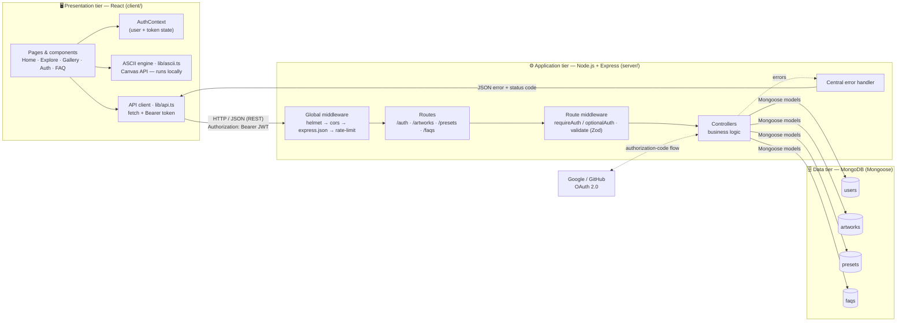
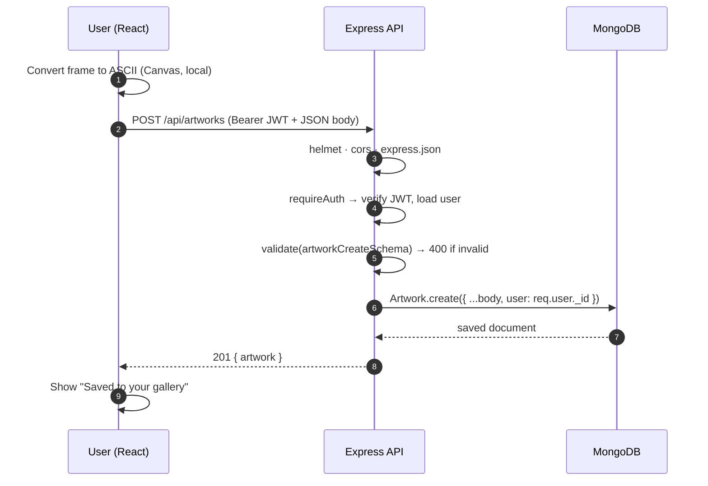
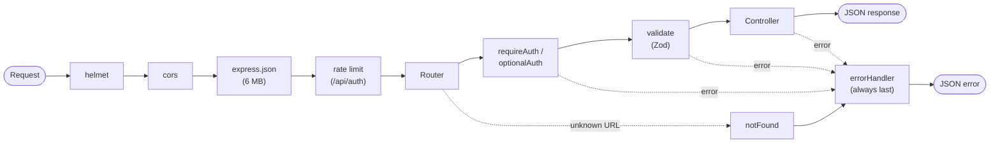
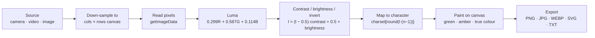
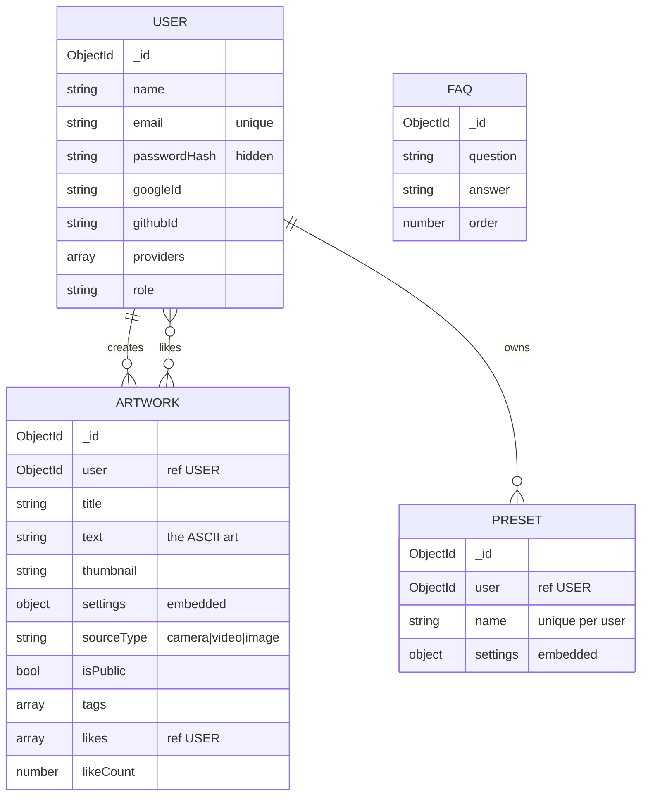
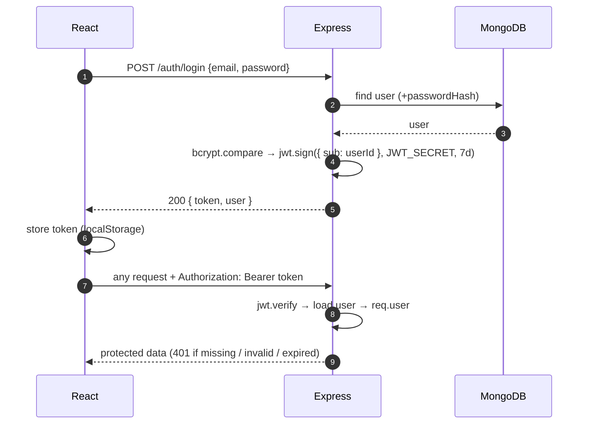

<div align="center">

# ░▒▓█ ASCII_CAM

### Live ASCII Art Converter — Full Stack MERN Application

**Convert your camera, videos and images to live ASCII art, save it to a MongoDB-backed gallery, share it publicly, and keep your favourite settings as presets.**


`React.js (client)` &nbsp;→&nbsp; `REST API (Node.js + Express)` &nbsp;→&nbsp; `MongoDB (Mongoose)`

</div>

---

## 📄 Project documents

| Document | Link |
|---|---|
| 📘 **Project Report** (architecture, roles, technical design) | [`Project-Report.pdf`](./Project-Report.pdf) |
| 🎞️ **Project Presentation** (PDF) | [`Project-Presentation.pdf`](./Project-Presentation.pdf) |
| 🎨 **Presentation on Canva** (live slides) | [canva.link/j3mpdkxmngtvhqc](https://canva.link/j3mpdkxmngtvhqc) |


---

## Table of contents

1. [Overview](#1-overview)
2. [System architecture](#2-system-architecture)
3. [Technology stack](#3-technology-stack)
4. [Database design](#4-database-design)
5. [API summary](#5-api-summary)
6. [Authentication flow](#6-authentication-flow)
7. [Quick start](#7-quick-start)
8. [Project structure](#8-project-structure)
9. [Testing](#9-testing)
10. [Team](#10-team)

---

## 1. Overview

ASCII_CAM turns visual input into text-based art **in real time**. The picture is mapped to characters **inside the browser** (Canvas API), so live preview needs no server and nothing is uploaded. Signed-in users can save results to a gallery in MongoDB, share them with a public link, like other people's art, and re-use their favourite conversion settings as presets.

| Feature | Description |
|---|---|
| 🎥 **Live conversion** | Webcam, uploaded video, or image → ASCII, with a live FPS/size readout |
| 🎛️ **Adjustable look** | 20–500 columns, contrast, brightness, 5 character sets, 3 colour modes, invert, mirror |
| 💾 **Export** | PNG, JPG, WEBP, SVG, plain TXT, or copy to clipboard |
| 🖼️ **Gallery (CRUD)** | Save, list, search, filter, sort, paginate, rename, make public/private, delete |
| 🌍 **Public sharing** | Public art is viewable at `/gallery/:id` by anyone, no login needed |
| ❤️ **Likes** | One like per user, "Most liked" sorting, "Liked" tab |
| 🎚️ **Presets** | Save the current settings by name and re-apply in one click |
| 🔐 **Accounts** | Email + password (bcrypt, JWT) and optional Google / GitHub sign-in |

---

## 2. System architecture

The application follows a **three-tier architecture**. The frontend **never** talks to the database directly — every operation goes through the backend REST API.

### 2.1 High-level view



**Plain-text version**

```
   React (client/)                  Express (server/)                      MongoDB
┌─────────────────────┐  REST   ┌──────────────────────────────┐ Mongoose ┌────────────┐
│ Pages & components  │ ──────► │ helmet → cors → json parser  │ ───────► │ users      │
│ AuthContext (JWT)   │ ◄────── │ → rate limit → routes        │ ◄─────── │ artworks   │
│ lib/api.ts (fetch)  │  JSON   │ → auth + validate middleware │          │ presets    │
│ Canvas ASCII engine │         │ → controllers → errorHandler │          │ faqs       │
└─────────────────────┘         └──────────────────────────────┘          └────────────┘
   (conversion runs                      ▲
    locally, no API)                     └── Google / GitHub OAuth 2.0
```

### 2.2 Layer responsibilities

| Tier | Folder | Responsibility |
|---|---|---|
| **Presentation** | `client/` | UI, routing, forms, in-browser ASCII conversion, calling the REST API, showing loading / error / empty states |
| **Application** | `server/` | REST endpoints, authentication, validation, ownership rules, error handling |
| **Data** | MongoDB | Persistent storage of users, artworks, presets, FAQs; indexes and constraints |

### 2.3 Request lifecycle — "Save to gallery"



1. The user converts a frame in the browser; the dashboard builds a snapshot (text, ≤320 px JPEG thumbnail, settings, source type).
2. `lib/api.ts` sends `POST /api/artworks` with the JWT in the `Authorization` header.
3. Express runs the middleware chain in order: `helmet → cors → express.json → rate limiter → router`.
4. `requireAuth` verifies the token and loads the user; `validate` checks the body with a Zod schema (400 on failure).
5. The controller creates the document; the owner id comes from the **token**, never from the request body.
6. Mongoose validates against the schema and MongoDB stores the document.
7. The API replies `201` with JSON; React updates state and shows the result. Any error goes through the central handler and returns `{ "error": { "message", "details" } }`.

### 2.4 Server middleware pipeline



### 2.5 In-browser ASCII conversion pipeline



Rows are computed as `rows = round(cols × h × 6 / (w × 12))` because a character cell is about twice as tall as it is wide. For live sources the resolution adapts automatically (reduced if a frame takes > 15 ms, increased if < 8 ms) to hold a smooth frame rate.

---

## 3. Technology stack

| Layer | Technology | Used for |
|---|---|---|
| **Frontend** | React 18, TypeScript, Vite 5, Tailwind CSS, `react-router-dom` 6, Radix UI, `lucide-react` | UI, routing, state (hooks + Context API), Canvas conversion, REST calls via `fetch` |
| **Backend** | Node.js ≥ 18 (ES modules), Express 4 | REST API, routing, middleware, business logic |
| **Database** | MongoDB 7 + Mongoose 8 (Docker or Atlas) | Users, artworks, presets, FAQs |
| **Auth** | `jsonwebtoken`, `bcryptjs`, OAuth 2.0 (Google, GitHub) | Stateless login, password hashing, social sign-in |
| **Validation** | Zod | Request body / query validation |
| **Security** | `helmet`, `cors`, `express-rate-limit` | Secure headers, origin allow-list, brute-force limit |
| **Testing** | Node test runner + Supertest | API tests |
| **Tooling** | `concurrently`, Docker Compose | Run both servers with one command; local MongoDB |

---

## 4. Database design



| Collection | Notable rules and indexes |
|---|---|
| `users` | `email` unique + lowercase; `passwordHash` is `select: false` and removed from JSON; sparse indexes on `googleId` / `githubId` |
| `artworks` | Indexes `{user, createdAt}`, `{isPublic, createdAt}`, `{isPublic, likeCount, createdAt}`, `{isPublic, tags}`; the heavy `text` field is left out of list queries |
| `presets` | Unique compound index `{user, name}` → duplicate name returns 409 |
| `faqs` | Seeded automatically on first server start |

**Design choices:** users are *referenced* by `ObjectId` (shared, independent); `settings` is *embedded* (always read with its owner); `likeCount` is a *denormalised* counter so "Most liked" is an indexed sort.

---

## 5. API summary

**Base URL** `http://localhost:5001/api` · JSON · `Authorization: Bearer <token>`

| Method | Endpoint | Auth | Purpose | Success |
|---|---|---|---|---|
| GET | `/health` | – | API + database status | 200 |
| POST | `/auth/register` | – | Create account | 201 |
| POST | `/auth/login` | – | Log in, returns JWT | 200 |
| GET | `/auth/me` | ✔ | Current user | 200 |
| GET | `/auth/google` · `/auth/github` | – | Start social sign-in | 302 |
| GET | `/artworks?scope=public\|mine\|liked&page&search&sort&source&tag` | optional | List (paginated) | 200 |
| GET | `/artworks/:id` | optional | One artwork (private → owner only) | 200 |
| POST | `/artworks` | ✔ | **Create** | 201 |
| PATCH | `/artworks/:id` | ✔ owner | **Update** title / visibility / tags | 200 |
| DELETE | `/artworks/:id` | ✔ owner | **Delete** | 204 |
| POST | `/artworks/:id/like` | ✔ | Toggle like | 200 |
| GET · POST | `/presets` | ✔ | List / create presets | 200 · 201 |
| PUT · DELETE | `/presets/:id` | ✔ | Replace / delete preset | 200 · 204 |
| GET | `/faqs` | – | FAQ list | 200 |

**Status codes:** `200` OK · `201` Created · `204` No Content · `400` validation / bad id · `401` not authenticated · `404` not found (also used for someone else's private art) · `409` duplicate · `413` payload too large · `500` server error.

**Error format (everywhere):**
```json
{ "error": { "message": "Validation failed",
             "details": [ { "field": "email", "message": "Enter a valid email" } ] } }
```

---

## 6. Authentication flow



- Passwords are stored **only** as bcrypt hashes (10 rounds).
- Ownership is enforced **inside the database query** (`{ _id, user: req.user._id }`), so one user cannot edit or delete another user's art.
- Google / GitHub sign-in uses the OAuth 2.0 authorization-code flow; accounts with the same verified email are linked, and the app token is returned in the URL hash (`/auth/callback#token=…`) which is cleared immediately.

---

## 7. Quick start

**Needs:** Node.js 18+ and MongoDB (Docker, local, or a free MongoDB Atlas cluster).

```bash
# 1. Database (pick one)
docker compose up -d                  # local MongoDB on port 27017
#    or use an Atlas connection string in server/.env

# 2. Configure the server
cp server/.env.example server/.env    # then edit MONGO_URI, JWT_SECRET, ...

# 3. Install everything (root + server + client)
npm run install:all

# 4. Run API (http://localhost:5001) and React app (http://localhost:5173) together
npm run dev
```

Open <http://localhost:5173>, create an account, go to **Explore**, make some art and press **Save**.
Health check: <http://localhost:5001/api/health> → `{"status":"ok","db":"connected"}`.
Demo art for the public gallery: `npm --prefix server run seed:gallery`

### Environment variables — `server/.env`

| Variable | Meaning | Default |
|---|---|---|
| `PORT` | API port (5001 because macOS reserves 5000) | `5001` |
| `MONGO_URI` | Local or Atlas connection string (URL-encode special characters in the password, e.g. `@` → `%40`) | local MongoDB |
| `JWT_SECRET` | Long random string used to sign tokens — **set it in production** | `dev-only-secret` |
| `JWT_EXPIRES` | Token lifetime | `7d` |
| `CLIENT_ORIGIN` | Allowed front-end origin(s), comma-separated (CORS + OAuth redirect) | `http://localhost:5173` |
| `SERVER_URL` | Public URL of the API (OAuth callbacks) | `http://localhost:<PORT>` |
| `GOOGLE_CLIENT_ID/SECRET`, `GITHUB_CLIENT_ID/SECRET` | Optional social sign-in; a button appears only when both values are set | empty |

`client/.env` → `VITE_API_URL`: leave empty in development (Vite proxies `/api` to the server); in production set it to the deployed API, e.g. `https://<api-host>/api`.

> 🔒 Never commit `server/.env`. It is already listed in `.gitignore`.

### Scripts

| Command | What it does |
|---|---|
| `npm run install:all` | Install root, server and client dependencies |
| `npm run dev` | Start API + React together |
| `npm test` | Run the API tests |
| `npm run build` | Type-check and build the React app |
| `npm --prefix server run seed:gallery` | Add demo artworks to the public gallery |

---

## 8. Project structure

```
FSD-PROJECT/
├── Project-Report.pdf            # full project report
├── Project-Presentation.pdf      # presentation (also on Canva)
├── docker-compose.yml            # local MongoDB 7
├── package.json                  # root scripts (dev, test, build, install:all)
├── docs/                         # detailed guide, earlier documentation, screenshots
│
├── client/                       # ── React frontend (Vite + TypeScript + Tailwind)
│   └── src/
│       ├── App.tsx               # providers + routes
│       ├── lib/api.ts            # REST client, token storage, typed endpoints
│       ├── lib/ascii.ts          # ASCII conversion engine + SVG export
│       ├── context/AuthContext.tsx
│       ├── components/           # Navbar, LikeButton, ascii/{AsciiDashboard,SavePanel,PresetPanel}, ui/*
│       └── pages/                # Gallery, ArtworkPage, AuthPage, AuthCallback, FaqPage, NotFound
│
└── server/                       # ── Node + Express backend (ES modules)
    ├── src/
    │   ├── server.js             # connect DB → seed → listen
    │   ├── app.js                # middleware chain + routers
    │   ├── validators.js         # Zod schemas
    │   ├── config/               # env.js, db.js
    │   ├── models/               # User, Artwork, Preset, Faq
    │   ├── routes/               # auth, artworks, presets, faqs
    │   ├── controllers/          # auth, oauth, artworks, presets
    │   ├── middleware/           # auth (JWT), validate (Zod), error
    │   └── seed/                 # faqs.js, gallery.js
    └── tests/                    # api.test.js, crud.test.js
```

Pattern on the server: **routes → middleware → controllers → models → MongoDB** (MVC style).

---

## 9. Testing

```bash
npm test
```

| File | Needs MongoDB? | Covers |
|---|---|---|
| `server/tests/api.test.js` | No | Health check, JSON 404, validation 400s, malformed JSON, protected routes → 401, bad token → 401 |
| `server/tests/crud.test.js` | Yes (`MONGO_URI_TEST`) | Register / login, duplicate 409, artwork create-read-update-delete, private-art visibility, likes, filters, preset CRUD |

```bash
docker compose up -d
MONGO_URI_TEST=mongodb://127.0.0.1:27017/ascii_cam_test npm test
```

> ⚠️ The CRUD test **drops the test database** first — never point `MONGO_URI_TEST` at real data.

Manual testing: Postman / Thunder Client for every endpoint (success, invalid input, missing token, wrong id), MongoDB Compass / Atlas to verify stored data, and the browser DevTools Network tab for the full user flow.

---

## 10. Team

| Member | Role | Owns |
|---|---|---|
| [**Pankaj Pandurang Tike**](https://github.com/pankajt25) | React Frontend Development | UI, components, routing, state management, ASCII engine, client-side API integration |
| [**Shashank Patel**](https://github.com/allenasat044-prog) | Express / Node.js Backend & APIs | Server setup, REST endpoints, controllers, middleware, validation, error handling |
| [**Rishu Gupta**](https://github.com/vampire0011) | MongoDB & Database | Schema design, Mongoose models, queries, indexes, relationships, seed data |
| [**Priyanshu Kumar**](https://github.com/Priyanshu1115) | Authentication, Integration, Testing & Deployment | JWT + bcrypt auth, social sign-in, frontend ↔ backend integration, API testing, hosting, Git workflow |


---

<div align="center">

**░▒▓█ ASCII_CAM — React · Express · MongoDB**

[Report](./Project-Report.pdf) · [Presentation](./Project-Presentation.pdf) · [Canva slides](https://canva.link/j3mpdkxmngtvhqc)

</div>
