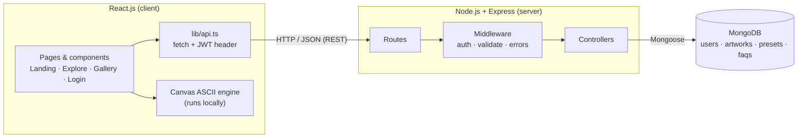
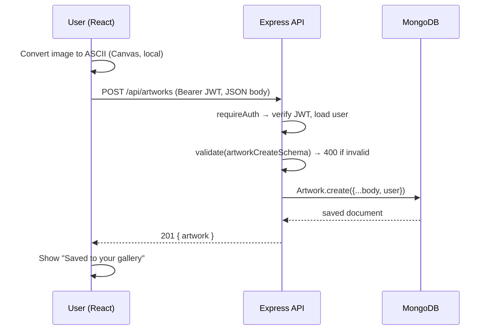
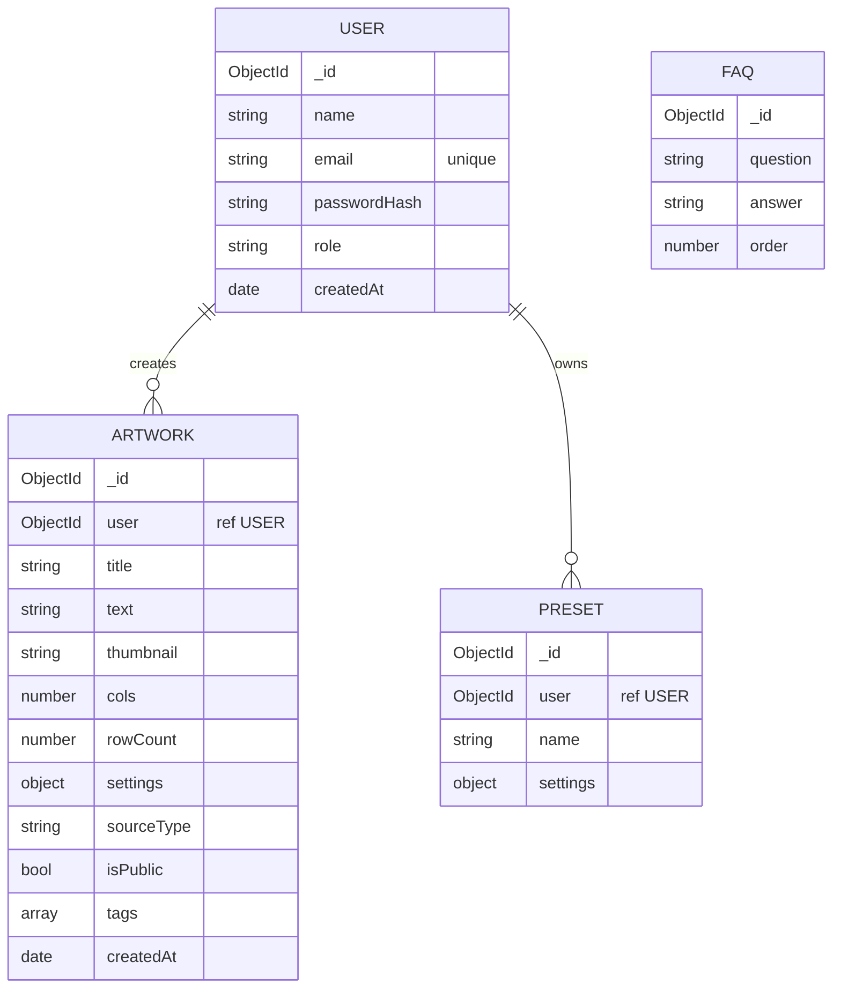

# ASCII_CAM — Project Documentation

**Course:** Full Stack Development (FSD) · **Stack:** React.js → Node.js + Express.js → MongoDB
**Team / Group:** _[fill in]_ · **Date:** _[fill in]_

---

## 1. Overview
ASCII_CAM turns a webcam feed, a video file or an image into ASCII art in the browser. Signed-in users can **save** their art to a gallery stored in MongoDB, make it **public or private**, **rename or delete** it, and keep their favourite converter settings as **presets**. A public gallery shows art shared by everyone. The landing page FAQ is read from the database.

**Why this is full stack:** the React UI never touches the database. Every save, list, edit, delete, login and preset goes through the Express REST API, which validates the request, checks the user's JWT and reads/writes MongoDB through Mongoose.

## 2. Technology stack
| Layer | Technology | Used for |
|---|---|---|
| Frontend | React 18, TypeScript, Vite, Tailwind CSS | UI, converter (Canvas API), calls the API with `fetch` |
| Backend | Node.js, Express 4 | REST API, routing, middleware |
| Database | MongoDB + Mongoose 8 | Users, artworks, presets, FAQs |
| Auth | JWT (`jsonwebtoken`), `bcryptjs` | Stateless login, password hashing |
| Validation | Zod | Request body / query validation |
| Security | Helmet, CORS, express-rate-limit | Headers, origin allow-list, brute-force limit |
| Testing | Node test runner + Supertest | API tests |

## 3. Architecture



Plain-text version (for the report):
```
 React.js (client)              Express.js (server)                 MongoDB
 ┌──────────────────┐  REST    ┌─────────────────────────┐ Mongoose ┌──────────────┐
 │ Pages/components │ ───────► │ routes → middleware →   │ ───────► │ users        │
 │ lib/api.ts (JWT) │ ◄─────── │ controllers             │ ◄─────── │ artworks     │
 │ Canvas converter │  JSON    │ (auth, validate, errors)│          │ presets, faqs│
 └──────────────────┘          └─────────────────────────┘          └──────────────┘
```

**Request flow — saving art**


**Frontend / backend separation:** `client/` and `server/` are independent npm projects. They only share the HTTP contract in section 6. In development Vite proxies `/api` to `http://localhost:5000`; in production set `VITE_API_URL`.

## 4. Folder structure
```
client/src
  components/ui/parallax-hero.tsx     landing hero (wilderness parallax)
  components/ui/features-card.tsx     feature cards
  components/ascii/AsciiDashboard.tsx converter dashboard (camera/video/image)
  components/ascii/SavePanel.tsx      "Save to gallery"  → POST /api/artworks
  components/ascii/PresetPanel.tsx    presets            → /api/presets
  components/Navbar.tsx, Faq.tsx      navigation, FAQ    → GET /api/faqs
  pages/Gallery.tsx, AuthPage.tsx     gallery (list/edit/delete), login/register
  context/AuthContext.tsx             user + token state
  lib/api.ts, lib/ascii.ts            REST client, ASCII engine
server/src
  server.js, app.js                   start-up, Express app
  config/                             env + MongoDB connection
  models/                             User, Artwork, Preset, Faq (Mongoose)
  routes/ → controllers/              auth, artworks, presets, faqs
  middleware/                         auth (JWT), validate (Zod), error handling
  validators.js                       Zod schemas
  seed/faqs.js                        default FAQ documents
server/tests                          api.test.js, crud.test.js
```

## 5. Database design (MongoDB)



| Collection | Key fields | Indexes / rules |
|---|---|---|
| `users` | name, email, passwordHash (bcrypt, never returned), role | `email` unique, lowercase |
| `artworks` | user (ref), title, **text** (the ASCII art), thumbnail (small JPEG data-URL), cols, rowCount, settings{cols, contrast, brightness, charset, mode, invert, mirror}, sourceType (`camera/video/image`), isPublic, tags[] | `{user, createdAt}`, `{isPublic, createdAt}` for the two list queries |
| `presets` | user (ref), name, settings{…} | unique `{user, name}` |
| `faqs` | question, answer, order | seeded on first start |

Relationships: one user → many artworks, one user → many presets (referenced by `user` ObjectId; `populate("user","name")` is used to show the author in the public gallery).
**Design choice:** the art is stored as text inside the artwork document (≈ 5–125 KB, far below MongoDB's 16 MB limit). The heavy `text` field is excluded from list queries (`select("-text")`) and only returned by `GET /api/artworks/:id`.

## 6. REST API details
Base URL: `http://localhost:5000/api` · Body/response format: JSON · Auth: `Authorization: Bearer <token>`
Errors always look like `{ "error": { "message": "...", "details": [ { "field", "message" } ] } }`.

| Method | Endpoint | Auth | Description | Success | Errors |
|---|---|---|---|---|---|
| GET | `/health` | – | API + DB status | 200 | – |
| POST | `/auth/register` | – | Create account `{name,email,password}` | 201 `{token,user}` | 400, 409 |
| POST | `/auth/login` | – | Log in `{email,password}` | 200 `{token,user}` | 400, 401 |
| GET | `/auth/me` | ✔ | Current user | 200 `{user}` | 401 |
| GET | `/artworks?scope=public\|mine&page&limit&search` | public / ✔ for `mine` | **Read** list (paginated, searchable) | 200 `{items,page,pages,total}` | 400, 401 |
| GET | `/artworks/:id` | optional | **Read** one, incl. `text` (private → owner only) | 200 `{artwork}` | 400, 404 |
| POST | `/artworks` | ✔ | **Create** artwork | 201 `{artwork}` | 400, 401, 413 |
| PATCH | `/artworks/:id` | ✔ owner | **Update** `title / isPublic / tags` | 200 `{artwork}` | 400, 401, 404 |
| DELETE | `/artworks/:id` | ✔ owner | **Delete** | 204 | 401, 404 |
| GET | `/presets` | ✔ | List my presets | 200 `{items}` | 401 |
| POST | `/presets` | ✔ | Create preset `{name,settings}` | 201 `{preset}` | 400, 409 |
| PUT | `/presets/:id` | ✔ | Replace preset | 200 `{preset}` | 400, 404 |
| DELETE | `/presets/:id` | ✔ | Delete preset | 204 | 404 |
| GET | `/faqs` | – | FAQ list from MongoDB | 200 `{items}` | – |

**Validation (Zod):** email format, password 8–72 chars, title 1–80 chars, `cols` 20–500, `contrast` 0.3–3, `brightness` −0.5–0.5, charset/mode/sourceType enums, thumbnail must be a `data:image/` URL, update body must contain at least one field.
**Error handling:** one central `errorHandler` maps Zod errors → 400, invalid ObjectId → 400, duplicate key → 409, bad/expired JWT → 401, oversized body → 413, malformed JSON → 400, anything else → 500 with a generic message (details are logged, not leaked).
**Security:** passwords hashed with bcrypt, JWT expires in 7 days, owner checks are part of the query (`{_id, user}`), Helmet headers, CORS allow-list, rate limit on `/auth`.

### Example
```http
POST /api/artworks
Authorization: Bearer eyJhbGciOi...
{ "title":"Me, 2026", "text":"@@%%\n##**", "cols":4, "rowCount":2,
  "settings":{"cols":120,"contrast":1.2,"brightness":0,"charset":"detailed","mode":"green","invert":false,"mirror":true},
  "sourceType":"camera", "isPublic":true }
→ 201 { "artwork": { "_id":"…", "title":"Me, 2026", "isPublic":true, … } }
```

## 7. How the pieces connect (end-to-end flow)
1. **Register / Log in** → `AuthPage` calls `api.register/login` → Express validates, hashes/compares the password, returns a JWT → stored in `localStorage`; `AuthContext` holds the user.
2. **Convert** → `AsciiDashboard` + `lib/ascii.ts` convert frames on the client (nothing is uploaded).
3. **Save** → `SavePanel` builds `{text, thumbnail, settings, …}` → `POST /api/artworks` → saved in MongoDB.
4. **Gallery** → `Gallery.tsx` calls `GET /api/artworks?scope=public|mine`, then `PATCH` (rename / public ↔ private) and `DELETE`.
5. **Presets** → `PresetPanel` calls `/api/presets` to store and re-apply converter settings.
6. **FAQ** → `Faq.tsx` calls `GET /api/faqs` (falls back to built-in text if the API is down).

## 8. Running and testing
See the root `README.md`. Tests: `npm test`.
- `api.test.js` (no database needed): health, JSON 404, validation 400s, malformed JSON, protected routes → 401, bad token → 401.
- `crud.test.js` (needs MongoDB): register/login, duplicate email 409, create/read/update/delete artwork, private-art visibility, preset CRUD and duplicate 409. Run with `MONGO_URI_TEST=mongodb://127.0.0.1:27017/ascii_cam_test npm test`.

## 9. Team roles and individual contributions
Every member must be able to explain their own part **and** the full flow in section 7.

| Role | Member | Owns (files) | Can explain |
|---|---|---|---|
| React Frontend Development | _[name]_ | `client/src/components/*`, `pages/*`, `App.tsx`, `lib/ascii.ts` | Components, state/hooks, props, conditional rendering, Canvas conversion, calling APIs |
| Express / Node.js Backend & APIs | _[name]_ | `server/src/app.js`, `routes/*`, `controllers/*`, `middleware/error.js`, `middleware/validate.js`, `validators.js` | REST design, status codes, middleware chain, validation, error handling |
| MongoDB & Database | _[name]_ | `server/src/models/*`, `config/db.js`, `seed/faqs.js`, section 5 | Schemas, refs/populate, indexes, queries, pagination, CRUD operations |
| Authentication, Integration & Testing | _[name]_ | `middleware/auth.js`, `controllers/auth.js`, `client/src/lib/api.ts`, `context/AuthContext.tsx`, `server/tests/*` | JWT + bcrypt flow, CORS/proxy, token header, end-to-end test, Supertest |

For a team of 3 or 5, merge or split these rows (e.g. split React into "Landing + Gallery" and "Converter dashboard").

## 10. Application screenshots (add to `docs/screenshots/`)
| File name | What to capture |
|---|---|
| `01-landing.png` | Landing page hero |
| `02-features-faq.png` | Feature cards and FAQ |
| `03-register-login.png` | Register / login form (include one validation error) |
| `04-explore-converter.png` | Explore dashboard converting a live camera or image |
| `05-save.png` | Save panel with the "Saved to your gallery" message |
| `06-my-gallery.png` | "My creations" with rename / make public / delete buttons |
| `07-public-gallery.png` | Public gallery with search and pagination |
| `08-mongodb.png` | MongoDB Compass showing the `artworks` collection |
| `09-api-test.png` | Postman / terminal showing a `POST /api/artworks` request and 201 response |

## 11. Demo / presentation outline (≈ 8 minutes)
1. Problem and idea (30 s) 2. Architecture diagram: React → Express → MongoDB (1 min) 3. Live demo: register → convert → save → gallery → rename → make public → delete (3 min) 4. Show the same data in MongoDB Compass (1 min) 5. API walk-through in Postman, including an error case (1 min) 6. Validation, auth and error handling (1 min) 7. Team roles, learnings and future work (30 s).
**Future work:** likes/comments, GIF export of live ASCII, admin role, deployment (Render/Railway + Atlas + Vercel).

## 12. Viva preparation — likely questions
- **Architecture:** What is the request path from button click to database? Why separate `client/` and `server/`? What does the Vite proxy do and why is CORS configured?
- **React:** What are `useState`, `useEffect`, `useRef`, context? Why is the camera loop in a `useRef`/`requestAnimationFrame` instead of state? How does `AuthContext` keep the user logged in after refresh?
- **Express / REST:** What is middleware? Explain `requireAuth` vs `optionalAuth`. Why PATCH for rename but POST for create? Which status codes do you return and why (201, 204, 400, 401, 404, 409)? Where is validation done?
- **MongoDB:** Why is `user` an ObjectId reference, and what does `populate` do? Why indexes on `{isPublic, createdAt}`? How does pagination work (`skip`/`limit`)? Why is `text` excluded from list queries? Embedded vs referenced documents?
- **Auth:** How is the password stored? What is inside a JWT? Where is the token kept and what are the trade-offs? How do you stop user A deleting user B's art? (owner check in the query: `{ _id, user }`)
- **Errors/testing:** What happens with an invalid id or a duplicate email? What do your tests cover?
